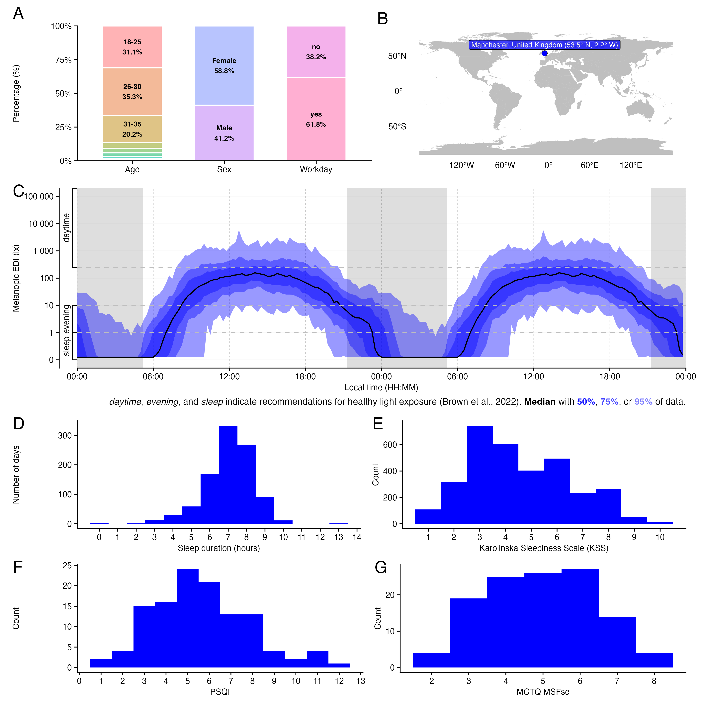

<!-- README.md is generated from README.Rmd. Please edit that file -->

### The dataset provided here is a combined and harmonised collection of personal light exposure, sleep, and subjective sleepiness data from Manchester, UK, spanning multiple phases of the study.

**Version v2.0.0**

<figure>

<figcaption aria-hidden="true">(A) frequency of age, sex, and workdays,
(B) location of data collection, (C) double plot of median,
interquartile range (50%), 75%, and 95% ribbons of light exposure across
all participants, shaded areas indicate nighttime from civil dusk to
civil dawn, (D) histogram of sleep duration, (E) histogram of sleepiness
scores, (F) histogram of PSQI scores, and (G) histogram of MCTQ
MSFsc.</figcaption>
</figure>

### About this repository

This dataset comprises personal light exposure data collected in
Manchester, UK, by the [University of
Manchester](https://www.manchester.ac.uk/) using the
[Spectrawear](https://ieeexplore.ieee.org/document/10401974) wrist-worn
light sensor device, which measures melanopic lux exposure. The
protocols require participants to wear the light logger during daytime
and remove it during sleep, placing it on the bedside table in the same
room near eye level.

The first phase of data collection was conducted using a real-world data
collection protocol, as described in Didikoglu et al. (2023),
“Associations between light exposure and sleep timing and sleepiness
while awake in a sample of UK adults in everyday life” (DOI:
[10.1073/pnas.2301608120](https://www.pnas.org/doi/10.1073/pnas.2301608120)).

The second phase of data collection followed an enhanced protocol
published on Protocols.io (DOI:
[10.17504/protocols.io.n92ldrjjxg5b](https://dx.doi.org/10.17504/protocols.io.n92ldrjjxg5b/v1)).
In this protocol, the same data as in Phase 1 were collected, along with
additional cognitive and light sensitivity measures. The corresponding
publication is Didikoglu et al. (2026), “Relationships between light
exposure and aspects of cognitive function in everyday life” (DOI:
[10.1038/s44271-025-00373-9](https://doi.org/10.1038/s44271-025-00373-9)).

The dataset presented here is a combined and harmonised compilation of
personal light exposure, sleep, and subjective sleepiness data from
multiple phases of research conducted in Manchester, UK. Light exposure
records of less than two days in duration were excluded from the
dataset. Sleep and sleepiness data are included only when corresponding
light exposure data are available.

### Citation

APA reference:

> Didikoglu, A. (2026). Personal light exposure, sleep, and subjective
> sleepiness data from Manchester, UK (Version 2.0.0) \[Data set\]. URL:
> <https://github.com/altugdidikoglu/UK_Wearable_Light_Dataset>.

## Summary of the dataset

|  |  |
|----|----|
| Period of data collection (total) | February 2022 – August 2023 |
| Location | Manchester, UK |
| Number of participants included in this repository | N = 119 |
| Duration of experiment for each participant | 7 days (starting from any weekday) |

### Included files

- `LICENSE`: Licensing terms. This dataset is published with a
  permissive CC0-1.0 license

All data are anonymous.

Each data file includes information from all participants.

| File name | Content |
|----|----|
| **light/SW\_\[Participant_id\].csv** | **MEDI**: Melanopic Equivalent Daylight Illuminance (lux), recorded every 30 seconds. **Datetime**: Measurement timestamps are in local time (“Europe/London” timezone). |
| **sleep.csv** | **Date** & **wake_datetime** & **bedtime_datetime**: Survey completion timestamps are recorded in local time (“Europe/London” timezone). Wake and sleep times are also reported in local time. **Sleep duration**: Subjectively reported total sleep duration (in hours). **Sleep onset latency**: Time taken to fall asleep (in minutes). **Sleep quality**: Self-reported using a 5-point Likert scale ranging from *very bad* to *very good*. Self-reported yes/no responses for **workday_yesterday** and **nap_yesterday**. |
| **kss.csv** | **KSS**: Karolinska Sleepiness Scale, ranging from 1 to 10 (where 10 indicates the highest level of sleepiness). **Date** & **Time**: Survey completion timestamps are recorded in local time (“Europe/London” timezone). |
| **screening.csv** & **MCTQ.csv** & **PSQI.csv** | Demographic information for the sample includes age, sex. Additionally, sleep midpoint time (MSFsc) was measured using the Munich Chronotype Questionnaire, and sleep quality was measured using the Pittsburgh Sleep Quality Index. |
